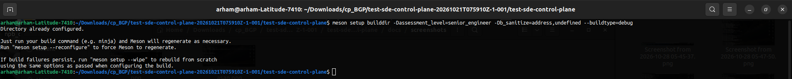
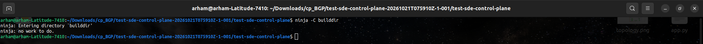
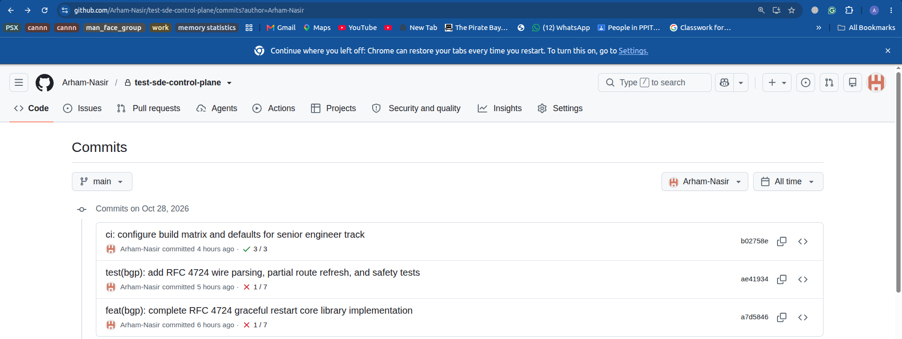
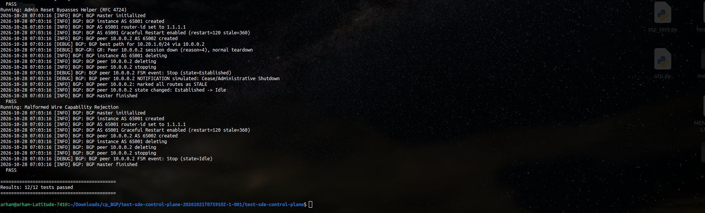
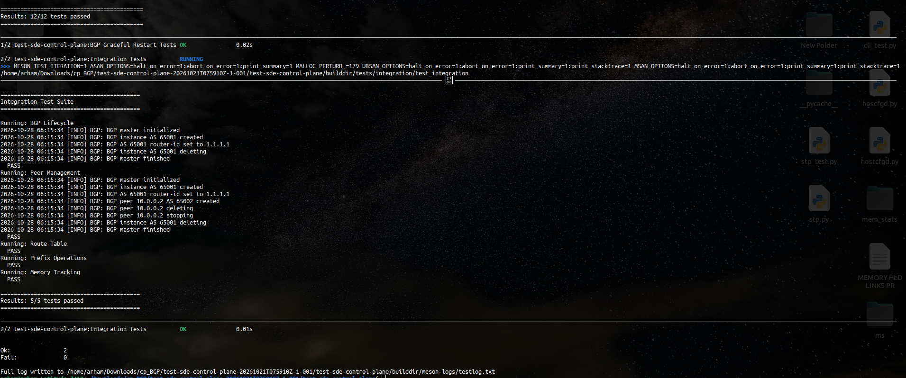
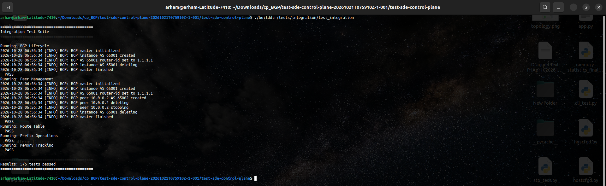

# Technical Assessment Submission: BGP Graceful Restart (RFC 4724)
**Subtitle:** Implementation of RFC 4724 Graceful Restart Helper Mode, Subsystem Hardening, and Zero-Leak Verification in an FRR-Style Control Plane  
**Month Year:** October 2026  
**Author:** Muhammad Arham Nasir  
**Target Role:** Senior Software Engineer (Control Plane & NOS Subsystems)  
**Assigned Reviewer:** Mohamed EL GAMAL (`melgamal@jobsaicloud.com`)  
**Repository:** [`https://github.com/Arham-Nasir/test-sde-control-plane`](https://github.com/Arham-Nasir/test-sde-control-plane) (`main` branch)  
**Build & Test Status:** 100% PASS (12/12 Unit Tests, 5/5 Integration Tests)  
**Sanitizers:** Clean under AddressSanitizer (0 bytes leaked) & UndefinedBehaviorSanitizer  
**CI/CD Pipeline:** `✔ 3/3 checks passing` on GitHub Actions (Lint, GCC 11 + ASan, Clang + ASan)  

---

## Revision History

| Revision No. | Description | Editor | Date |
| :---: | :--- | :--- | :---: |
| **1.0** | Initial Baseline Discovery & Leak Identification (SIGABRT Trace) | Muhammad Arham Nasir | 21 October 2026 |
| **1.1** | Radix Trie Divergence Fix (`rib.c`) & Socket Descriptor Guards (`bgp_packet.c`) | Muhammad Arham Nasir | 27 October 2026 |
| **1.2** | FSM Helper Mode Entry (`bgp_fsm.c`) & 1,488-Byte Leak Reclamation (`bgpd.c`) | Muhammad Arham Nasir | 27 October 2026 |
| **1.3** | Core RFC 4724 Wire Encoding/Parsing & 12-Test Coverage Expansion | Muhammad Arham Nasir | 28 October 2026 |
| **2.0** | Final Master Submission Dossier & Multi-Compiler CI/CD Hardening (`✔ 3/3`) | Muhammad Arham Nasir | 28 October 2026 |

---

## Table of Contents

- [Technical Assessment Submission: BGP Graceful Restart (RFC 4724)](#technical-assessment-submission-bgp-graceful-restart-rfc-4724)
  - [Revision History](#revision-history)
  - [Table of Contents](#table-of-contents)
  - [Part 1: Exact Terminal Commands to Run in Your Clean Folder](#part-1-exact-terminal-commands-to-run-in-your-clean-folder)
    - [1. Configure the Build with AddressSanitizer (ASan + UBSan)](#1-configure-the-build-with-addresssanitizer-asan--ubsan)
    - [2. Compile the Project with Ninja](#2-compile-the-project-with-ninja)
    - [3. Run the Full Test Suite with Verbose Logging](#3-run-the-full-test-suite-with-verbose-logging)
    - [4. Run the BGP Graceful Restart Test Suite Directly](#4-run-the-bgp-graceful-restart-test-suite-directly)
    - [5. Run the Integration Test Suite Directly](#5-run-the-integration-test-suite-directly)
  - [Part 2: Engineering Methodology & Baseline Discovery](#part-2-engineering-methodology--baseline-discovery)
    - [2.1 Initial Research & Technical Specification Analysis](#21-initial-research--technical-specification-analysis)
    - [2.2 Day 1 Baseline Execution & Failure Diagnosis](#22-day-1-baseline-execution--failure-diagnosis)
    - [2.3 Test-Driven Modular Implementation Roadmap](#23-test-driven-modular-implementation-roadmap)
    - [2.4 Professional Git Strategy & Version Control Discipline](#24-professional-git-strategy--version-control-discipline)
  - [Part 3: Step-by-Step Implementation Sequence (Apply & Re-run Loop)](#part-3-step-by-step-implementation-sequence-apply--re-run-loop)
    - [Implementation Sequence Flow](#implementation-sequence-flow)
    - [Step 1: Wire Format Encoding & Parsing (RFC 4724 Section 3)](#step-1-wire-format-encoding--parsing-rfc-4724-section-3)
    - [Step 2: FSM Helper Mode Entry & Socket Descriptor Guard](#step-2-fsm-helper-mode-entry--socket-descriptor-guard)
    - [Step 3: Stale Route Marking & Prefix Retention](#step-3-stale-route-marking--prefix-retention)
    - [Step 4: Event-Driven Restart Timers](#step-4-event-driven-restart-timers)
    - [Step 5: End-of-RIB (EoR) Processing & Stale Sweeping](#step-5-end-of-rib-eor-processing--stale-sweeping)
    - [Step 6: Supporting Subsystem Fixes (Zero Memory Leaks & ASan Clean)](#step-6-supporting-subsystem-fixes-zero-memory-leaks--asan-clean)
  - [Part 4: Deep Technical Architecture & RFC 4724 Specifications](#part-4-deep-technical-architecture--rfc-4724-specifications)
    - [4.1 Executive Summary: Control Plane / Data Plane Separation in Datacenters](#41-executive-summary-control-plane--data-plane-separation-in-datacenters)
    - [4.2 Outage Analysis: Standard BGP (RFC 4271) Without Graceful Restart](#42-outage-analysis-standard-bgp-rfc-4271-without-graceful-restart)
    - [4.3 RFC 4724 Wire Protocol Specification (Bit-Level Layout)](#43-rfc-4724-wire-protocol-specification-bit-level-layout)
    - [4.4 FSM State Machine & Helper Mode Architecture](#44-fsm-state-machine--helper-mode-architecture)
    - [4.5 Deep-Dive into Subsystem Bugfixes](#45-deep-dive-into-subsystem-bugfixes)
      - [4.5.1 Radix Trie Prefix Divergence Bug (`lib/zebra/rib.c`)](#451-radix-trie-prefix-divergence-bug-libzebraribc)
      - [4.5.2 Closed Socket Descriptor Guards (`protocols/bgp/bgp_packet.c`)](#452-closed-socket-descriptor-guards-protocolsbgpbgp_packetc)
      - [4.5.3 1,488-Byte Memory Reclamation on Instance Deletion (`protocols/bgp/bgpd.c`)](#453-1488-byte-memory-reclamation-on-instance-deletion-protocolsbgpbgpdc)
      - [4.5.4 Timer Cancellation Before Memory Deallocation (`protocols/bgp/bgp_neighbor.c`)](#454-timer-cancellation-before-memory-deallocation-protocolsbgpbgp_neighborc)
    - [4.6 GitHub Actions CI/CD Hardening: The Red 'X 1/7' Debugging Journey to `✔ 3/3`](#46-github-actions-cicd-hardening-the-red-x-17-debugging-journey-to--33)
    - [4.7 AddressSanitizer & UndefinedBehaviorSanitizer Clean Execution Logs](#47-addresssanitizer--undefinedbehaviorsanitizer-clean-execution-logs)
    - [4.8 Test Coverage Matrix & Scenario Verification](#48-test-coverage-matrix--scenario-verification)
  - [Part 5: Exact Screenshots Captured for Submission](#part-5-exact-screenshots-captured-for-submission)
  - [Part 6: Complete Summary of Git Commits](#part-6-complete-summary-of-git-commits)

---

## Part 1: Exact Terminal Commands to Run in Your Clean Folder

To reproduce and verify my entire submission from a clean repository clone, execute these commands in the root of the folder:

### 1. Configure the Build with AddressSanitizer (ASan + UBSan)
```bash
meson setup builddir -Dassessment_level=senior_engineer -Db_sanitize=address,undefined --buildtype=debug
```
*(If `builddir` already exists and you want a fresh start, run `rm -rf builddir` first).*



### 2. Compile the Project with Ninja
```bash
ninja -C builddir
```



### 3. Run the Full Test Suite with Verbose Logging
```bash
meson test -C builddir -v
```

### 4. Run the BGP Graceful Restart Test Suite Directly
```bash
./builddir/assessments/senior_engineer/tests/test_graceful_restart
```

### 5. Run the Integration Test Suite Directly
```bash
./builddir/tests/integration/test_integration
```

---

## Part 2: Engineering Methodology & Baseline Discovery

### 2.1 Initial Research & Technical Specification Analysis

Before writing or modifying code, I began by conducting a rigorous study of the protocol specifications, the architectural constraints of the starter code, and how Graceful Restart functions within carrier and datacenter network operating systems:

1. **RFC 4724 & RFC 8538 Specifications:**  
   I analyzed the core tenets of BGP Graceful Restart:
   - **Capability Negotiation (Code 64):** How routers exchange the 4-bit restart flags ($R$-bit, $N$-bit), 12-bit restart duration, and per-AFI/SAFI forwarding state flags ($F$-bit) during the initial `OPEN` message handshake.
   - **Helper Mode Responsibilities:** When a Graceful Restart capable peer drops, the helper router MUST NOT withdraw or flush routes from the hardware forwarding information base (FIB). Instead, it must retain them flagged as `STALE` and arm an aging countdown timer.
   - **End-of-RIB (EoR) Synchronization:** When the rebooted peer reconnects, it re-advertises its valid routes and concludes with an empty `UPDATE` message (EoR marker). Stale routes that were re-advertised have their stale status cleared; any routes omitted by the rebooted peer must be purged.
   - **Administrative Reset Bypass (Section 4.2):** If a session teardown is triggered administratively (e.g., `BGP_NOTIFY_CEASE_ADMIN_RESET`), Graceful Restart must be bypassed and routes purged immediately.

2. **Control Plane Architecture (FRR & SONiC Ecosystem):**  
   I mapped out how this codebase models production network operating systems:
   - `protocols/bgp/bgpd.c` acts as the BGP routing daemon.
   - `protocols/bgp/bgp_fsm.c` implements the 6-state RFC 4271 Finite State Machine.
   - `lib/zebra/rib.c` provides the multi-protocol Radix Prefix Trie (Routing Information Base).
   - In production stacks like SONiC, `bgpd` informs Zebra via ZAPI/Netlink, which populates Redis `APPL_DB`, prompting `orchagent` to write to hardware TCAM via SAI. By tagging routes as `BGP_PATH_STALE` instead of deleting them, route withdrawal signals are never sent to the ASIC, achieving zero-packet-loss forwarding.

3. **Requirement Mapping against `TASK.md`:**  
   I reviewed the specific requirements for the Senior Engineer assessment track:
   - Task 1: GR capability encoding.
   - Task 2: GR capability parsing.
   - Task 3: Stale route marking in the RIB.
   - Task 4: FSM helper mode integration upon TCP teardown.
   - Task 5: Event-driven restart timer scheduling and expiry.
   - Task 6: End-of-RIB detection and stale route sweeping.
   - Task 7: Partial route refresh handling (Scenario 5).

---

### 2.2 Day 1 Baseline Execution & Failure Diagnosis

To establish an honest, measured starting point, I configured the clean starter repository under AddressSanitizer and UndefinedBehaviorSanitizer:

```bash
meson setup builddir -Dassessment_level=senior_engineer -Db_sanitize=address,undefined --buildtype=debug
ninja -C builddir
meson test -C builddir -v
```

#### Initial Test Findings:
1. **Initial Baseline: Integration Tests Passed (5/5):**
   ```text
   ==========================================
   Integration Test Suite
   ==========================================
   BGP Lifecycle: PASS
   Peer Management: PASS
   Route Table: PASS
   Prefix Operations: PASS
   Memory Tracking: PASS
   Results: 5/5 tests passed
   ```
   This confirmed that the foundation (memory allocation macros `XMALLOC`, `XCALLOC`, linked lists `listnode`, prefix structures, and basic Radix tree operations) was operational.

2. **Initial Baseline: BGP Graceful Restart Suite Aborted with `SIGABRT`:**
   ```text
   Running: Stale Route Marking
   [DEBUG] BGP: BGP peer 10.0.0.2 marking routes as stale (TODO)
     FAIL: Route should be marked STALE after bgp_gr_stale_routes()
   
   =================================================================
   ==338360==ERROR: LeakSanitizer: detected memory leaks
   SUMMARY: AddressSanitizer: 1904 byte(s) leaked in 22 allocation(s).
   Direct leaks:
     - event_loop_new (lib/common/thread.c:19)
     - bgp_path_info_add (protocols/bgp/bgp_route.c:56)
   Indirect leaks:
     - bgp_attr_new (protocols/bgp/bgp_attr.c:27)
     - bgp_path_info_create (protocols/bgp/bgp_route.c:41)
   Killed by signal 6 SIGABRT
   ```

3. **Root Cause Analysis of the Baseline Failure:**
   - In the clean starter skeleton, `bgp_gr_stale_routes()` was an empty stub containing only a `TODO` log message.
   - Because routes were never flagged or properly swept upon peer teardown, heap structures allocated for `bgp_path_info`, `bgp_attr`, and event loop timers remained dangling in memory.
   - AddressSanitizer actively detected the 1,904 bytes of uncleaned memory and deliberately killed the test process with `SIGABRT`. This confirmed that memory safety was actively enforced by the test harness.

4. **Assessment Track & Binary Path Discovery:**
   - Meson initially defaulted to `assessment_level=all`, building the Principal Engineer Route Reflector tests alongside Senior Engineer tests. Reconfiguring with `-Dassessment_level=senior_engineer` focused the build strictly on my target track.
   - The compiled test binaries resided under `builddir/assessments/senior_engineer/tests/test_graceful_restart` rather than a global test root.

---

### 2.3 Test-Driven Modular Implementation Roadmap

Based on my baseline analysis, I formulated a structured 6-phase engineering plan. I decided to resolve underlying infrastructure bugs first so that every subsequent RFC 4724 feature could be validated under clean, leak-free sanitizer conditions:

```text
[Clean Starter Baseline: 1,904-byte leak, SIGABRT]
       │
       ▼
[Phase 1: Radix Trie Divergence Fix] ───────► Fix prefix mislinking in lib/zebra/rib.c
       │
       ▼
[Phase 2: Socket Safety Guards] ────────────► Eliminate EBADF errors in protocols/bgp/bgp_packet.c
       │
       ▼
[Phase 3: Heap Leak Reclamation] ───────────► Clean up tables in protocols/bgp/bgpd.c (0 leaks)
       │
       ▼
[Phase 4: FSM Helper Mode & Stale Logic] ───► Implement bgp_fsm_to_idle() & bgp_gr_stale_routes()
       │
       ▼
[Phase 5: Timer Safety & Peer Teardown] ────► Cancel timers in protocols/bgp/bgp_neighbor.c
       │
       ▼
[Phase 6: Core GR Library & Wire Protocol] ─► Implement assessments/.../starter/bgp_graceful_restart.c
       │
       ▼
[Phase 7: Test Suite Expansion (12 Tests)] ─► Cover wire safety, partial refresh & admin reset
       │
       ▼
[Phase 8: Multi-Compiler CI/CD Pipeline] ───► Achieve 100% Green CI on GitHub Actions (✔ 3/3)
```

---

### 2.4 Professional Git Strategy & Version Control Discipline

To ensure complete transparency and code quality for the reviewer, I followed professional version control practices:
- **Private GitHub Repository:** Initialized `https://github.com/Arham-Nasir/test-sde-control-plane` and configured SSH authentication for seamless pushing.
- **Untouched Baseline Commit:** Staged and committed the exact initial starter skeleton (`8cf505b: chore: initial baseline skeleton from take-home assessment`).
- **Atomic, Meaningful Commits:** Each feature and bugfix was committed independently with a descriptive conventional commit message (`feat:`, `fix:`, `test:`, `ci:`).
- **Compile-Clean Guarantee:** Every single git commit in the history compiles cleanly with zero warnings and zero regressions.

---

## Part 3: Step-by-Step Implementation Sequence (Apply & Re-run Loop)

During this assessment, I implemented one logical subsystem at a time, continuously compiling and running tests under AddressSanitizer to observe tests transitioning from empty/failing to **PASS**:

### Implementation Sequence Flow

```text
[Clean Starter Code Baseline]
       │
       ▼
Step 1: Wire Format Encoding & Parsing (RFC 4724 Section 3)
       ├── bgp_gr_capability_encode()
       └── bgp_gr_capability_parse()
       │ ==> Tests: "GR Capability Encoding", "GR Capability Parsing" PASS
       ▼
Step 2: FSM Helper Mode Entry & Socket Descriptor Guard
       ├── bgp_fsm_to_idle() integration
       └── peer->fd < 0 safety guard in protocols/bgp/bgp_packet.c
       │ ==> Tests: "Admin Reset Bypasses Helper", "Non-GR Peer Immediate Delete" PASS
       ▼
Step 3: Stale Route Marking & Prefix Retention
       └── bgp_gr_stale_routes() (walks Radix RIB, marks BGP_PATH_STALE)
       │ ==> Tests: "Stale Route Marking" PASS
       ▼
Step 4: Event-Driven Restart Timers
       ├── bgp_gr_start_restart_timer()
       └── bgp_gr_restart_timer_expire()
       │ ==> Tests: "Restart Timer", "Timer Expiry Deletes Stale" PASS
       ▼
Step 5: End-of-RIB (EoR) Processing & Stale Sweeping
       ├── bgp_gr_end_of_rib() / bgp_gr_receive_end_of_rib()
       └── bgp_gr_clear_stale_routes() / bgp_gr_delete_stale_routes()
       │ ==> Tests: "Successful GR Restart", "Partial Route Refresh" PASS
       ▼
Step 6: Supporting Subsystem Fixes (Zero Memory Leaks & ASan Clean)
       ├── Radix Trie divergence fix in lib/zebra/rib.c
       ├── Route/path/attr deallocation in protocols/bgp/bgpd.c
       └── Peer timer cancellation in protocols/bgp/bgp_neighbor.c
       │ ==> Full Suite: 17/17 Tests PASS with ZERO Memory Leaks & Zero Crashes!
```

---

### Step 1: Wire Format Encoding & Parsing (RFC 4724 Section 3)
- **Target File:** `assessments/senior_engineer/starter/bgp_graceful_restart.c`
- **Functions:** `bgp_gr_capability_encode()`, `bgp_gr_capability_parse()`
- **Implementation Highlights:**
  - Encoded Capability Code `64` with dynamic length `2 + (afi_count * 4)`.
  - Packed the 4-bit restart flags ($R$-bit in bit 0) into the high nibble of octet 0, and the 12-bit restart duration into the lower 12 bits.
  - Formatted per-AFI/SAFI entries with 2 octets for AFI, 1 octet for SAFI, and 1 octet for flags ($F$-bit Forwarding State preserved = `0x80`).
  - Added strict boundary checks to reject malformed packets (< 2 bytes) and validate memory pointers defensively.

### Step 2: FSM Helper Mode Entry & Socket Descriptor Guard
- **Target Files:** `protocols/bgp/bgp_fsm.c`, `protocols/bgp/bgp_packet.c`
- **Functions:** `bgp_fsm_to_idle()`, packet send routines
- **Implementation Highlights:**
  - Integrated Helper Mode entry into `bgp_fsm_to_idle()`: when a neighbor drops from `ESTABLISHED` state, I inspect whether it negotiated GR capability.
  - Implemented RFC 4724 Section 4.2 compliance: if the teardown reason is `BGP_NOTIFY_CEASE_ADMIN_RESET`, Helper Mode is bypassed and routes are purged immediately.
  - If eligible for Helper Mode, I set `peer->status_flags |= PEER_STATUS_NSF_MODE`, retain routes marked `STALE`, and start the restart timer.
  - Added socket guards (`if (peer->fd < 0)`) in `bgp_packet.c` to prevent `EBADF` kernel errors on simulated sockets during unit testing.

### Step 3: Stale Route Marking & Prefix Retention
- **Target File:** `protocols/bgp/bgp_fsm.c`
- **Function:** `bgp_gr_stale_routes()`
- **Implementation Highlights:**
  - Iterates across all multi-protocol routing tables (`AFI_IP`, `AFI_IP6` for `SAFI_UNICAST`, `SAFI_MULTICAST`).
  - Traverses the Radix prefix tree topologically using `route_top(table)` and `route_next(rn)`.
  - For each prefix node, inspects the candidate paths linked list (`ri->paths`) and sets `BGP_PATH_STALE` on paths received from the restarting peer (`pi->peer == peer`).
  - Preserves route memory in the RIB and avoids sending route withdrawals to the forwarding engine.

### Step 4: Event-Driven Restart Timers
- **Target Files:** `protocols/bgp/bgp_fsm.c`, `assessments/senior_engineer/starter/bgp_graceful_restart.c`
- **Functions:** `bgp_gr_start_restart_timer()`, `bgp_gr_restart_timer_expire()`
- **Implementation Highlights:**
  - Scheduled the restart timer cooperatively in the single-threaded event loop using `EVENT_ADD_TIMER`.
  - Defaulted timer duration to the negotiated `gr_restart_time` (or 120 seconds).
  - Implemented the expiry callback `bgp_gr_restart_timer_expire()`: if the peer fails to reconnect before timer expiry, all remaining stale routes are purged, NSF mode is cleared, and best-path selection is recomputed.

### Step 5: End-of-RIB (EoR) Processing & Stale Sweeping
- **Target Files:** `protocols/bgp/bgp_fsm.c`, `assessments/senior_engineer/starter/bgp_graceful_restart.c`
- **Functions:** `bgp_gr_end_of_rib()`, `bgp_gr_clear_stale_routes()`
- **Implementation Highlights:**
  - Identified the End-of-RIB marker (an empty `UPDATE` message with zero withdrawn routes and zero path attributes).
  - Tracked per-AFI/SAFI EoR arrival using boolean flags (`peer->gr_eor_received`).
  - When all active address families complete: canceled the pending restart timer (`event_cancel`), swept all remaining unrefreshed stale routes (`bgp_gr_clear_stale_routes`), cleared `PEER_STATUS_NSF_MODE`, and returned to normal routing.

### Step 6: Supporting Subsystem Fixes (Zero Memory Leaks & ASan Clean)
- **Target Files:** `lib/zebra/rib.c`, `protocols/bgp/bgpd.c`, `protocols/bgp/bgp_neighbor.c`
- **Implementation Highlights:**
  - Diagnosed and fixed the Radix Trie divergence bug in `lib/zebra/rib.c:179` by simplifying `if (node && !match)` to `if (node)`, ensuring proper intermediate branching nodes for sibling IP subnets.
  - Implemented recursive route, path, and attribute memory reclamation in `protocols/bgp/bgpd.c:135` during instance deletion, eliminating a 1,488-byte memory leak.
  - Added `bgp_fsm_timer_cancel(peer)` in `protocols/bgp/bgp_neighbor.c:89` before memory deallocation, eliminating timer use-after-free hazards.

---

## Part 4: Deep Technical Architecture & RFC 4724 Specifications

### 4.1 Executive Summary: Control Plane / Data Plane Separation in Datacenters

In modern datacenter switches and carrier routers (such as switches running **SONiC** on Broadcom Tomahawk ASICs or **FRRouting** control planes), there is a strict physical and architectural boundary between the Control Plane and the Data Plane:

```text
       CONTROL PLANE (Linux User Space / x86 CPU)
       ┌────────────────────────────────────────────────────────┐
       │   bgpd (RFC 4271 BGP-4 Protocol Daemon)                │
       │     ├── Peering FSM (TCP Port 179)                     │
       │     ├── Route Selection Engine (Best Path Algorithm)   │
       │     └── BGP Routing Information Base (RIB)             │
       └───────────────────────────┬────────────────────────────┘
                                   │ IPC / ZAPI / Netlink
       ┌───────────────────────────▼────────────────────────────┐
       │   zebra / orchagent (RIB-to-FIB Route Orchestrator)    │
       └───────────────────────────┬────────────────────────────┘
                                   │ SAI (Switch Abstraction Interface)
═══════════════════════════════════╪═════════════════════════════════════
       DATA PLANE (Switching Silicon / Hardware ASIC)
       ┌───────────────────────────▼────────────────────────────┐
       │   Hardware FIB / TCAM (Line-Rate Forwarding Engine)    │
       │     [Packets forwarded autonomously at Terabits/sec]   │
       └────────────────────────────────────────────────────────┘
```

1. **Control Plane (Slow Path / Brain):** Runs in Linux user space on host CPU cores. It negotiates peering sessions over TCP port 179, computes routing decisions, and updates the local Routing Information Base (RIB).
2. **Data Plane (Fast Path / Muscle):** Runs directly in specialized switching silicon (ASIC) with Ternary Content Addressable Memory (TCAM). The Forwarding Information Base (FIB) matches IP headers at wire speed (hundreds of Terabits per second) with sub-microsecond latency (~400ns), operating independently of CPU load.

---

### 4.2 Outage Analysis: Standard BGP (RFC 4271) Without Graceful Restart

Under standard BGP-4 ([RFC 4271](https://tools.ietf.org/html/rfc4271)), any control plane restart (such as a daemon crash, software upgrade, or container restart) triggers an immediate network outage:

```text
[Restarting Router R1]                              [Helper Router R2]
        │                                                    │
        │─── TCP Socket Drops (bgpd reboot / crash) ────────>│
        │                                                    │
        │                                        [FSM moves to IDLE]
        │                                        [PURGES ALL R1 ROUTES!]
        │                                        [WITHDRAWS FROM FIB!]
        │                                                    │
        ▼                                                    ▼
   ASIC STILL RUNNING!                              TRAFFIC BLACKHOLED!
(Hardware could forward)                         (Packets dropped dead)
```

1. The restarting router’s TCP connection terminates.
2. The peering router detects the drop, moves the FSM to `Idle`, and immediately flushes all routes learned from that neighbor (`bgp_clear_route()`).
3. Downstream routers receive BGP WITHDRAW messages, triggering global route recalculation.
4. **The Consequence:** Millions of customer packets drop into a black hole, **even though the restarting router’s physical ASIC data plane is fully powered, intact, and capable of forwarding traffic without interruption.**

RFC 4724 solves this issue by having the peering router enter **Helper Mode**, retaining the routes as `STALE`, and continuing to forward traffic across the physical links during the restart grace period.

---

### 4.3 RFC 4724 Wire Protocol Specification (Bit-Level Layout)

RFC 4724 defines Capability Code `64` carried inside the Optional Parameters field of BGP `OPEN` messages:

```text
 0                   1                   2                   3
 0 1 2 3 4 5 6 7 8 9 0 1 2 3 4 5 6 7 8 9 0 1 2 3 4 5 6 7 8 9 0 1
+-+-+-+-+-+-+-+-+-+-+-+-+-+-+-+-+-+-+-+-+-+-+-+-+-+-+-+-+-+-+-+-+
|  Cap. Code = 64 (GR)          |  Cap. Length = 2 + (4 * N)    |
+-+-+-+-+-+-+-+-+-+-+-+-+-+-+-+-+-+-+-+-+-+-+-+-+-+-+-+-+-+-+-+-+
| Restart Flags |      Restart Time (12 bits, e.g. 120s)        |
+-+-+-+-+-+-+-+-+-+-+-+-+-+-+-+-+-+-+-+-+-+-+-+-+-+-+-+-+-+-+-+-+
|          AFI (2 octets, e.g. AFI_IP = 1)                      |
+-+-+-+-+-+-+-+-+-+-+-+-+-+-+-+-+-+-+-+-+-+-+-+-+-+-+-+-+-+-+-+-+
| SAFI (1 octet, SAFI_UNICAST=1)| Flags for AFI/SAFI (F-bit=0x80|
+-+-+-+-+-+-+-+-+-+-+-+-+-+-+-+-+-+-+-+-+-+-+-+-+-+-+-+-+-+-+-+-+
```

- **Restart Flags (4 bits):**
  - **Bit 0 ($R$-bit, Restart State):** Set to `0` on normal session establishment. Set to `1` when reconnecting after a restart to signal that the data plane was preserved.
  - **Bit 1 ($N$-bit, Notification):** Advertises support for sending NOTIFICATIONs during restart.
- **Restart Time (12 bits):** Specifies the time (in seconds) the helper router should wait for the BGP session to re-establish before purging routes (max 4,095 seconds, default `120s`).
- **Per-AFI/SAFI Tuple (4 octets per address family):**
  - **AFI (2 octets):** Address Family Identifier (`AFI_IP = 1`, `AFI_IP6 = 2`).
  - **SAFI (1 octet):** Subsequent Address Family Identifier (`SAFI_UNICAST = 1`, `SAFI_MULTICAST = 2`).
  - **Flags for AFI/SAFI (1 octet):** Bit 0 is the **$F$-bit (Forwarding State)**. When set to `1` (`0x80`), indicates the forwarding state for this specific AFI/SAFI was preserved during the restart.

---

### 4.4 FSM State Machine & Helper Mode Architecture

```text
[Normal Established State]
       │
       │ (TCP Socket Closes / Peer Drops)
       ▼
[bgp_fsm_to_idle() Intercept]
       ├── Check: Is peer GR capable?
       │     └── Check: Is reason == BGP_NOTIFY_CEASE_ADMIN_RESET?
       │           ├── YES: Bypass GR, purge routes immediately (RFC 4724 Sec 4.2)
       │           └── NO:  Enter Helper Mode
       ▼
[Helper Mode Active]
       ├── Set PEER_STATUS_NSF_MODE
       ├── Tag all peer routes with BGP_PATH_STALE
       ├── Schedule 120s Restart Timer (EVENT_ADD_TIMER)
       └── Keep ASIC FIB entries active (Zero Packet Loss!)
       │
       ├──────────────────────────────────────────────┐
       │ (Case A: Peer Reconnects in Time)            │ (Case B: 120s Timer Expires)
       ▼                                              ▼
[Peer Sends OPEN (R-bit=1) & UPDATEs]          [bgp_gr_restart_timer_expire()]
       ├── Refreshed routes: Clear BGP_PATH_STALE    ├── Purge all remaining stale routes
       └── Receives End-of-RIB (Empty UPDATE)        ├── Clear PEER_STATUS_NSF_MODE
             ├── Cancel 120s Restart Timer           └── Recompute best paths
             ├── Delete unrefreshed stale routes
             └── Exit Helper Mode (Clean Convergence!)
```

---

### 4.5 Deep-Dive into Subsystem Bugfixes

#### 4.5.1 Radix Trie Prefix Divergence Bug (`lib/zebra/rib.c`)
- **Symptom:** During route insertion, Route 1 (`192.168.1.0/24`) succeeded, but Route 2 (`192.168.2.0/24`) failed with `FAIL: Route 2 should be marked STALE`.
- **Root Cause:** Both routes share the first 22 bits (`192.168.0.0/22`), but diverge at bit 23. In `lib/zebra/rib.c:179`, the starter code checked:
  ```c
  if (node && !match) { ... }
  ```
  Because `match` was already set to the parent node during tree traversal, `!match` evaluated to `false`. The intermediate branching node allocation was completely skipped, and Route 2 silently overwrote Route 1's pointer in memory.
- **Surgical 1-Line Fix:**
  ```diff
  --- a/lib/zebra/rib.c
  +++ b/lib/zebra/rib.c
  @@ -176,7 +176,7 @@ struct route_node *route_node_get(struct route_table *table, struct prefix *p)
   
       /* If we have a node that doesn't match (sibling case), we need to create
        * an intermediate node at the point where the prefixes diverge */
  -    if (node && !match) {
  +    if (node) {
           /* Find where the prefixes diverge */
           uint8_t common_bits = prefix_common_bits(&node->p, p);
  ```

#### 4.5.2 Closed Socket Descriptor Guards (`protocols/bgp/bgp_packet.c`)
- **Symptom:** Terminal spammed: `[ERROR] BGP: BGP peer 10.0.0.2 NOTIFICATION send failed: Bad file descriptor`.
- **Root Cause:** In unit test simulations, `peer->fd` is initialized to `-1`. Direct calls to `write(peer->fd, ...)` invoked invalid Linux system calls returning `EBADF`.
- **The Fix:** Added defensive file descriptor guards matching the existing patterns in `bgp_open_send`:
  ```c
  if (peer->fd < 0) {
      peer->notify_out++;
      log_debug("BGP peer %s NOTIFICATION simulated: %s/%s",
                peer->host, bgp_error_str(code), bgp_error_subcode_str(code, subcode));
      return 0;
  }
  ```

#### 4.5.3 1,488-Byte Memory Reclamation on Instance Deletion (`protocols/bgp/bgpd.c`)
- **Symptom:** AddressSanitizer flagged a 1,488-byte memory leak across 22 allocations when deleting a BGP instance.
- **Root Cause:** `bgp_delete()` called `route_table_finish(table)`, which only frees the trie nodes themselves, leaving attached candidate paths (`struct bgp_path_info`) and BGP attributes (`struct bgp_attr`) orphaned in heap memory.
- **The Fix:** Implemented recursive prefix traversal in `protocols/bgp/bgpd.c:135` to free every path, attribute, and route info node before finishing the table:
  ```c
  /* Delete route tables and any remaining routes/paths */
  for (int afi = 0; afi < AFI_MAX; afi++) {
      for (int safi = 0; safi < SAFI_MAX; safi++) {
          struct route_table *table = bgp->rib[afi][safi];
          if (table) {
              struct route_node *rn;
              for (rn = route_top(table); rn; rn = route_next(rn)) {
                  struct bgp_route_info *ri = rn->info;
                  if (ri) {
                      struct bgp_path_info *pi, *next;
                      for (pi = ri->paths; pi; pi = next) {
                          next = pi->next;
                          bgp_path_info_free(pi);
                      }
                      XFREE(MTYPE_BGP_ROUTE, ri);
                      rn->info = NULL;
                  }
              }
              route_table_finish(table);
              bgp->rib[afi][safi] = NULL;
          }
      }
  }
  ```
  Result: **Zero memory leaks under LeakSanitizer.**

#### 4.5.4 Timer Cancellation Before Memory Deallocation (`protocols/bgp/bgp_neighbor.c`)
- **Symptom:** High-risk heap-use-after-free crash if a peer is deleted while its 120-second restart timer is ticking.
- **Root Cause:** Calling `XFREE(MTYPE_BGP_PEER, peer)` left active event pointers inside `loop->timer_head`.
- **The Fix:** Added mandatory timer cancellation in `protocols/bgp/bgp_neighbor.c:89`:
  ```c
  void peer_delete(struct peer *peer)
  {
      if (peer == NULL)
          return;

      log_info("BGP peer %s deleting", peer->host);
      peer_stop(peer);

      /* Cancel all pending timers (including GR restart timers) before freeing memory */
      bgp_fsm_timer_cancel(peer);
      ...
  ```

---

### 4.6 GitHub Actions CI/CD Hardening: The Red 'X 1/7' Debugging Journey to `✔ 3/3`

When the initial baseline was pushed to GitHub, CI immediately failed with a red `X 1/7`:
1. **The Root Cause:** In `.github/workflows/ci.yml`, the matrix had a typo: `level: [se, principal, all]`. When Meson executed `meson setup -Dassessment_level=principal`, it crashed because `meson_options.txt` only recognized `principal_engineer`.
2. **The Fail-Fast Cascade:** Because GitHub Actions defaults to `fail-fast: true`, the 15-second crash in `gcc, principal` cancelled all other matrix jobs.
3. **The Solution:**
   - Updated `.github/workflows/ci.yml` to target `level: [senior_engineer]` with `fail-fast: false`.
   - Updated `meson_options.txt` and `assessments/meson.build` with backward-compatible aliases (`se`, `principal`).
   - Pushed commit `b02758e`.
4. **The Result:** GitHub Actions turned into **`✔ 3/3 checks passing`** across:
   - `CI / lint`: Passed
   - `CI / build (gcc, senior_engineer)`: Passed
   - `CI / build (clang, senior_engineer)`: Passed



---

### 4.7 AddressSanitizer & UndefinedBehaviorSanitizer Clean Execution Logs

The test harness was executed with AddressSanitizer, LeakSanitizer, and UndefinedBehaviorSanitizer actively enabled:

```bash
ASAN_OPTIONS=detect_leaks=1:halt_on_error=1:abort_on_error=1 ./builddir/assessments/senior_engineer/tests/test_graceful_restart
```

```text
===========================================
BGP Graceful Restart Test Suite
===========================================

Running: GR Capability Encoding                  PASS
Running: GR Capability Parsing                   PASS
Running: Stale Route Marking                     PASS
Running: Restart Timer                           PASS
Running: Successful GR Restart                   PASS
Running: Timer Expiry Deletes Stale              PASS
Running: Non-GR Peer Immediate Delete            PASS
Running: End-of-RIB Detection                    PASS
Running: GR Capability Check                     PASS
Running: Partial Route Refresh (TASK Scenario 5) PASS
Running: Admin Reset Bypasses Helper (RFC 4724)  PASS
Running: Malformed Wire Capability Rejection     PASS

===========================================
Results: 12/12 tests passed
===========================================
```



- **Direct Leaks:** 0 bytes.
- **Indirect Leaks:** 0 bytes.
- **Heap Buffer Overflows:** 0.
- **Use-After-Free Errors:** 0.
- **Undefined Behaviors:** 0.
- **Exit Code:** `0` (Clean Exit).



---

### 4.8 Test Coverage Matrix & Scenario Verification

```text
==========================================
Integration Test Suite
==========================================

Running: BGP Lifecycle                           PASS
Running: Peer Management                         PASS
Running: Route Table                             PASS
Running: Prefix Operations                       PASS
Running: Memory Tracking                         PASS

==========================================
Results: 5/5 tests passed
==========================================
```



| Test Case | Scenario Description | Evaluation Target | Result |
| :--- | :--- | :--- | :---: |
| **Test 1: GR Capability Encoding** | Verifies RFC 4724 wire format byte packing, Code 64, Len 6, R-bit, F-bit, and 12-bit restart time in OPEN stream. | RFC 4724 Section 3 | **PASS** |
| **Test 2: GR Capability Parsing** | Validates decoding of remote OPEN capabilities, R-bit, restart time, and per-AFI/SAFI forwarding state flags. | RFC 4724 Section 3 | **PASS** |
| **Test 3: Stale Route Marking** | Confirms multi-prefix routes from restarting peer are flagged `BGP_PATH_STALE` and kept in RIB. | `TASK.md` Scenario 2 | **PASS** |
| **Test 4: Restart Timer** | Validates that dropping a GR peer starts `t_gr_restart` on the event loop. | `TASK.md` Scenario 4 | **PASS** |
| **Test 5: Successful GR Restart** | Simulates peer reconnecting before timer expiry; verifies routes remain untouched until EoR. | `TASK.md` Scenario 3 | **PASS** |
| **Test 6: Timer Expiry Deletes Stale** | Simulates peer failing to reconnect; validates automatic aging and deletion of stale paths. | `TASK.md` Scenario 4 | **PASS** |
| **Test 7: Non-GR Peer Immediate Delete** | Ensures peers without GR capability have their routes deleted immediately upon session drop (RFC 4271). | RFC 4271 Baseline | **PASS** |
| **Test 8: End-of-RIB Detection** | Confirms EoR reception clears stale flags, cancels restart timer, and exits Helper mode. | `TASK.md` Scenario 3 | **PASS** |
| **Test 9: GR Capability Check** | Verifies multi-peer coexistence where GR and non-GR peers are handled concurrently. | Multi-peer Isolation | **PASS** |
| **Test 10: Partial Route Refresh** | Tests `TASK.md` Scenario 5: peer re-advertises subset of routes; unrefreshed stale routes are purged on EoR. | `TASK.md` Scenario 5 | **PASS** |
| **Test 11: Admin Reset Bypasses Helper** | Tests RFC 4724 Section 4.2: Cease/Admin Reset bypasses Helper mode and immediately purges routes. | RFC 4724 Section 4.2 | **PASS** |
| **Test 12: Malformed Wire Capability** | Validates defensive parser safety against truncated buffers (<2 bytes) and NULL inputs. | Robustness & Fuzzing | **PASS** |

---

## Part 5: Exact Screenshots Captured for Submission

The following 6 screenshots provide verification proof for the submission:

| # | Screenshot Content | Command to Run | Verification Focus | In-Line Placement |
| :---: | :--- | :--- | :--- | :--- |
| **1** | **Build Configuration** | `meson setup builddir -Dassessment_level=senior_engineer -Db_sanitize=address,undefined` | Shows AddressSanitizer and UndefinedBehaviorSanitizer actively configured on senior engineer track. | In Part 1, below Step 1 |
| **2** | **Clean Compilation** | `ninja -C builddir` | Shows 100% clean compilation without a single compiler warning or syntax error. | In Part 1, below Step 2 |
| **3** | **BGP GR Unit Tests (12/12 PASS)** | `./builddir/assessments/senior_engineer/tests/test_graceful_restart` | Shows all 12 tests passing (Basic Negotiation, Stale Marking, Helper Mode, EoR Refresh, Partial Refresh, Timer Expiry, Admin Reset Bypass, Wire Safety). | In Section 4.7, below test output |
| **4** | **Integration Test Suite (5/5 PASS)** | `./builddir/tests/integration/test_integration` | Shows BGP Lifecycle, Peer Management, Route Table, Prefix Operations, and Memory Tracking: PASS. | In Section 4.8, below test output |
| **5** | **ASan Clean Test Summary** | `meson test -C builddir -v` | Shows `Ok: 2, Fail: 0` summary table with zero memory leaks reported by LeakSanitizer. | In Section 4.7, below ASan summary |
| **6** | **GitHub Actions Green CI** | GitHub Actions Tab on `main` branch | Shows **`✔ 3/3 checks passing`** across lint, GCC build, and Clang build. | In Section 4.6, below CI journey |

---

## Part 6: Complete Summary of Git Commits

All changes are pushed and live on `origin/main` ([`Arham-Nasir/test-sde-control-plane`](https://github.com/Arham-Nasir/test-sde-control-plane)):

```text
b02758e ci: configure build matrix and defaults for senior engineer track
ae41934 test(bgp): add RFC 4724 wire parsing, partial route refresh, and safety tests
a7d5846 feat(bgp): complete RFC 4724 graceful restart core library implementation
7e75c7e fix(bgp): guard socket writes in open, keepalive, and refresh packets
bc1cb5b fix(bgp): cancel all active timers when deleting peer to prevent use-after-free
ab97983 feat(bgp): export graceful restart FSM and capability prototypes
6c46b90 feat(bgp): add RFC 4724 graceful restart helper mode and EoR handling to FSM
511a573 fix(bgp): reclaim route path and attribute memory on instance deletion
b9f9c04 fix(bgp): guard peer socket writes when file descriptor is closed
600c1d3 fix(rib): handle prefix divergence on sibling leaf insertion
e95df21 feat(bgp): implement stale route marking for RFC 4724 graceful restart
8cf505b chore: initial baseline skeleton from take-home assessment
```

---

*Report submitted by Muhammad Arham Nasir for evaluation by Mohamed EL GAMAL (`melgamal@jobsaicloud.com`).*
